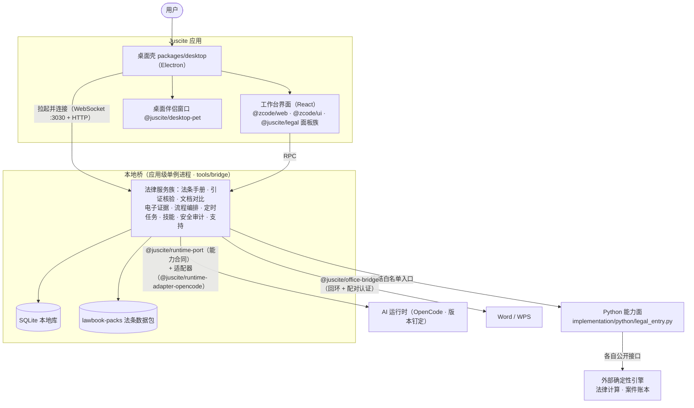

# 架构概览

本页回答"Juscite 由哪些部分组成、数据怎么流、哪些边界不许跨"，面向想读懂代码或评估产品的开发者。

## 范围

包含：组件全景、分层职责、一次请求的完整旅程、数据与隐私边界、工程合同面与验证门禁。
不包含：安装步骤（见[快速上手](getting-started.md)）与各包逐文件说明（见[自有包一览](packages.md)）。

## 全景

先用一段大白话定向：你在屏幕上看到的一切是**桌面壳里的工作台界面**；界面背后是一个常驻本机的**本地桥**进程，它是产品的服务中心——法条手册、引证核验、文档对比、电子证据、流程编排、定时任务、技能管理、安全审计都在桥上，数据落本地 SQLite；桥不自己"思考"，它通过一层**能力合同 + 适配器**调用钉定版本的 **AI 运行时**（OpenCode）完成生成类工作；另有一个 **Python 能力面**以固定白名单入口对接外部确定性引擎（法律计算、案件账本）。Word/WPS 的 Office 集成走独立的本地桥接服务。

下图看三件事：谁拉起谁（实线上下）、数据落在哪里（圆柱）、外部边界在哪里（虚线外侧）。

若图未渲染，文字版：桌面壳（`packages/desktop`）拉起工作台界面与桌面伴侣窗口，并以应用级单例方式拉起本地桥（`tools/bridge/bridge_host.mjs`，WebSocket 3030 端口 + HTTP）；界面经 RPC 调用桥上的法律服务族；桥读写本地 SQLite 与法条数据包，经 `@juscite/runtime-port` 能力合同与 OpenCode 适配器调用 AI 运行时，经 Python 白名单入口对接外部确定性引擎，并经 `@juscite/office-bridge` 与 Word/WPS 互操作。

## 分层职责

| 层 | 位置 | 职责 |
|---|---|---|
| 桌面壳 | `packages/desktop` | Electron 主进程/预加载/渲染；拉起本地桥；生产打包（Windows NSIS 安装器） |
| 工作台界面 | `packages/web`、`packages/ui`、`packages/client` | React 工作台；法律面板族经 `packages/ui/src/legal/register.tsx` 唯一注册点从 `@juscite/legal` 挂载 |
| 自有功能包 | `packages/juscite-*` | 面板、内核与集成件，一览见[自有包一览](packages.md) |
| 本地桥 | `tools/bridge` | 服务中心与数据归属：全部法律服务、SQLite 持久化、技能与任务调度 |
| AI 运行时接入 | `packages/juscite-runtime-port`、`packages/juscite-runtime-adapters/` | 产品自定义的最小能力合同（接口用自有域词，不照抄任何运行时 API）与落到 OpenCode 的适配器；换运行时只需新增适配器，产品层零改动 |
| Python 能力面 | `implementation/python` | `legal_entry.py` 以冻结方法白名单桥接外部确定性引擎；配置缺失或方法未知名义拒（fail-closed），绝不伪造成功 |
| 数据与配置 | `lawbook-packs/`、`config/` | 公有领域法条文本的确定性打包（sha256 完整性校验）；随客户端分发的内置默认配置 |
| 工程合同面 | `contracts/`、`scripts/gen-ref-graph.mjs` | 机器可读的边界合同，见下节 |

桌面壳与工作台界面的基础代码基于开源项目 ZCode（Apache-2.0）构建，Juscite 在其上加入法律工作台层、本地桥与自有包生态；归属声明见仓库根 `NOTICE`。

## 一次请求的旅程

以"引证核验"为例，看数据如何端到端流动：

1. 律师在研究面板选中一段判词中的法条引文，点"核验"。
2. 面板经 WebSocket RPC 把请求发给本地桥。
3. 桥上的核验服务启动轻量核验引擎，对照法条数据包逐条比对。
4. 每条引文返回明确结论：命中（附条文出处）或未命中；若法条包完整性校验失败，整个面板显示"法条包不可用"，不会降级使用残包。
5. 结果落本地库，可随时复查——这一步没有大模型参与，结论由确定性代码给出。

## 数据与隐私边界

- **本地优先**：会话与案件数据存本地 SQLite 和本地文件；本地桥只服务本机。
- **Office 集成只绑回环**：`@juscite/office-bridge` 绑定回环地址、动态端口，经发现文件与配对认证建立连接。
- **fail-closed**：未配置的能力（外部引擎、运行时）一律显示"未连接"，不伪造成功。
- **外部确定性引擎不随本仓库分发**：法律计算与案件账本引擎经各自公开接口对接，版本与检出位置见 `implementation/config/`。

## 工程合同面与门禁

Juscite 把"自有代码与基础壳之间的接面"钉成机器可读文件，接面漂移在门禁里自动爆红，而不是等运行时翻车：

| 文件 | 作用 |
|---|---|
| `contracts/pin-points.json` | 法律面板在壳内的注册/挂载/接线点清单 |
| `contracts/ref-graph.json` | 自有代码对合同包的符号级引用图（`scripts/gen-ref-graph.mjs` 生成） |
| `contracts/type-snapshot.json` | 被消费类型的声明快照，升级时 diff 即暴露协议形变 |
| `contracts/brand-exemptions.md` | 品牌检查的用户可见字符串豁免清单 |
| `contracts/adapter-budget.md` | 适配层规模纪律（适配器合计行数占桥代码比例上限） |
| `contracts/mod-map.json`、`contracts/exemptions/` | 接面修改分账与其余豁免 |

验证入口统一为 `tools/bridge/ci_gate.mjs`：

| 模式 | 覆盖 |
|---|---|
| `fast` | 语法检查、UI 合同测试、桥端到端测试、合成自测、品牌检查 |
| `persist` | `fast` + 桥进程重启后会话数据不丢的实测 |
| `package` | 打包门禁，且仅 Windows：NSIS（`electron-builder --win --x64`）+ 随包桥探针 `bridge_bundle_synthetic`。Linux 构建/产物不得称作 package 绿 |
| `upgrade` | 基础壳升级门禁：接面 patch 干净应用、类型快照 diff、适配层规模、品牌全量检查 |

## 实现锚点

| 关注点 | 位置 |
|---|---|
| 桥入口与服务装配 | `tools/bridge/bridge_host.mjs` |
| 门禁 | `tools/bridge/ci_gate.mjs` |
| 运行时能力合同 | `packages/juscite-runtime-port/src/index.ts` |
| OpenCode 适配器 | `packages/juscite-runtime-adapters/opencode/src/opencodeAdapter.mjs` |
| 面板注册点 | `packages/ui/src/legal/register.tsx` |
| Python 白名单入口 | `implementation/python/legal_entry.py` |
| 法条包构建 | `tools/bridge/lawbook_pack_build.mjs` |
| 引用图生成 | `scripts/gen-ref-graph.mjs` |

## 相关文档

- 想先把它跑起来：[快速上手](getting-started.md)，含环境与常见问题。
- 想找具体模块：[自有包一览](packages.md)，每个包的职责、版本与依赖。
