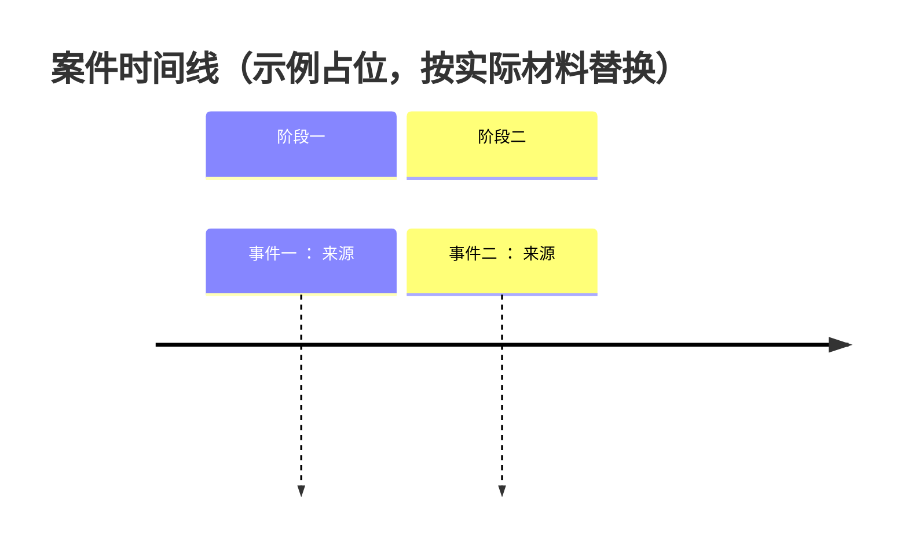

# 办案时间线整理

## 一、概述

| 项 | 说明 |
|---|---|
| 能力 | 从本案材料中抽取事件、统一要素、排序分组，形成可核查的案件事实时间线 |
| 输入 | 本案材料全文（起诉状、合同、往来函件、聊天记录、会议纪要、裁判文书等文本类材料） |
| 输出 | 时间线表格 / 时间轴图（Mermaid）/ 结构化事件清单，三选一或并列 |
| 三原则 | 客观：不添加材料未陈述的事实；完整：不遗漏对案情有关键影响的节点；可追溯：每个事件都能指回出处材料与位置 |

## 二、法律声明

1. 本技能产出是对材料的结构化整理，不构成法律意见，也不构成对事实的认定。
2. 时间线反映的是材料所载内容的整理结果，不等同于法院查明认定的事实。
3. 存在分歧或多方陈述不一致的节点，应当作出争议标注，而不是择一采信。
4. 各节点涉及的时效、期间等法律意义，需结合具体法律规范判断，本技能仅作提示不作结论。
5. 本技能定位为办案辅助工具，对外使用前应经执业律师复核。

## 三、事件要素（八字段）

每个事件按以下要素整理；材料未提供的信息如实留空，禁止编造：

| 要素 | 要求 | 落点 |
|---|---|---|
| 时间节点 | 必填；精确到日写 YYYY-MM-DD，把握不足写原文时段描述 | date / date_label |
| 事件描述 | 必填；能用性质词概括的用性质词（如开庭、调解、判决），不能的写短句 | event_type / note |
| 涉及主体 | 必填；写材料原文主体名称 | payload.subjects |
| 行为性质 | 推荐；白名单外的法律性质原文 | payload.behavior_nature |
| 涉及金额 | 如有；只抄原文写法，不换算不计算 | payload.amount_text |
| 证据来源 | 必填；每条事件至少一条，材料名+页码或段落定位（双引用缺一不可），尽量附原句摘录；查不到出处的节点不输出、不猜页码 | source_refs |
| 争议标记 | 如有；多方陈述不一致时标注并附说明 | status / payload.dispute_note |
| 备注 | 可选；补充说明 | note |

## 四、时间粒度选择

按案件复杂度选一档，并在输出开头注明所用粒度：

| 粒度 | 适用 | 表现 |
|---|---|---|
| 宏观（年月） | 事件多而时间跨度长、日级精度无实益 | 只保留年月 |
| 中观（日） | 常规民商事案件 | 保留到日 |
| 微观（时分） | 关键行为以小时计的节点（如拦截、交付、报警） | 保留到时分 |
| 复合 | 主线用日级、个别关键事件用时分 | 主线日级+关键事件时级 |

## 五、节点法律意义提示

下列节点类型的法律意义应在整理时留意并提示复核（不写结论）：

| 节点类型 | 通常关注点 |
|---|---|
| 合同成立/签订 | 履行期起算、管辖连接点 |
| 履行/付款期限 | 违约起算、时效起算参考 |
| 催告/通知送达 | 解除权行使、宽限期起算 |
| 损害发生/知悉 | 侵权时效起算、除斥期间 |
| 起诉/仲裁申请 | 时效中断、程序启动 |
| 裁判送达/生效 | 上诉期、申请执行期 |
| 分期付款约定 | 计划时点与实际履行的区分 |

## 六、操作五步

1. **材料理解**：先通读全部材料，识别材料类型与时间线相关度；无关材料如实标注不强行抽取。
2. **逐事件抽取**：按五条抽取规则处理——显性时间直取；隐性时间按上下文推算；推不出绝对时间的写相对描述并标待核；长时段标起止；不同材料对同一事件时间不一致的标争议。
3. **排序分组合并**：按时间排序；按自然阶段分组（如磋商/签订/履行/违约/争议解决）；同一时间点多事件合并展示；多材料同一事件去重合并（出处都保留）。
4. **交叉验证**：时间矛盾检查；每个事件挂证据来源；识别空白期并提示；关键节点重点复核。
5. **输出生成**：按用户选择的格式输出；未指定时默认表格。

## 七、输出规范

- 日期统一 YYYY-MM-DD 或原文时段描述；同一主体跨材料名称不一致时以首次出现为准并注明别名。
- 逐条出处与置信度：每个事件至少附一条（材料名+页码/段落）双引用出处；AI 整理行同时给出置信度 confidence（0-1 小数的确凿程度自评，拿不准给低值不填高），缺出处如实标注待补、不编造不猜页码。
- 语言中性：不使用评价性词汇（如故意、恶意等），只陈述材料记载的内容。
- 来源四级标注：
  | 级别 | 标注 | 用法 |
  |---|---|---|
  | 文件证实 | 不加标注 | 材料明确记载 |
  | 委托人所述 | 据悉 | 仅委托人单方陈述 |
  | 初步阅读 | 据资料显示 | 推断性内容 |
  | 冲突待核 | 待核实 | 多源不一致 |
- 特殊标记五枚：⚠️ 待确认 ｜ 🔴 事实争议 ｜ 🟡 间接推断 ｜ 🔵 程序节点 ｜ ⭐ 关键节点。

## 八、输出三格式

1. **时间线表格**（默认）：列=日期｜事件｜主体｜来源｜标记。
2. **时间轴图**（Mermaid）：

3. **结构化事件清单**（JSON）：元素字段与第八节表格落点一致（event_type/date/date_label/note/expires_at/status/importance/phase/side/payload/source_refs，payload 内含 subjects/behavior_nature/amount_text/dispute_note/confidence），可直接入库。

> 范围注记：时间轴图以 Mermaid 承载；drawio 版式（基线+圆形节点+六类节点配色+时效虚线框标注）不在本版范围，列为后续项。

## 九、场景重点

| 场景 | 关注节点 |
|---|---|
| 合同纠纷 | 签订→履行→催告→解除送达→时效起算 |
| 侵权 | 行为→损害→知悉→因果链→持续侵权分段 |
| 劳动争议 | 入职→工资支付周期→解除→仲裁申请 |
| 知识产权 | 权利取得→侵权行为→发现日→保全→禁令 |
| 刑事 | 预备→实施→结果→到案与强制措施→审判进程 |
| 婚姻家事 | 登记→感情破裂事件→分居→财产变动→起诉 |

## 十、质量自检清单

交付前逐项自查：

1. ☐ 已按内容分类整理（非纯流水）
2. ☐ 分类内按时间排序
3. ☐ 每个事件标注了来源
4. ☐ 来源与陈述不一致处已备注
5. ☐ 已提示持续更新方式（新料随案补充）
6. ☐ 核心材料反复核对过
7. ☐ 先分类案卷再抽取
8. ☐ 每个事件挂了证据来源
9. ☐ 空白期已补充说明或标注
10. ☐ 关键节点已作特殊标记

## 十一、关联技能

- 证据目录生成：时间线的事件来源清单可移交证据目录任务继续整理；反之证据目录完成后可回填时间线来源。
- 期限计算：时效类节点的具体期间计算应交由期限引擎完成，本技能只负责把节点日期整理准确。

## 十二、局限性

- 时间精度受材料本身限制，模糊描述只能如实保留。
- 抽取质量依赖材料完整度，缺材料的时间段只能留白。
- 产出不构成事实认定；复杂因果链的还原超出结构化整理的能力范围。
- 哪些事件算"关键节点"含主观判断，应以办案律师复核为准。

## 十三、英文诉讼线：证明地图（Proof Map）

当时间线用于组织诉讼证明（而非单纯事实梳理）时，在通用整理之上追加一层策略评估：

1. **策略三分类**：每个事件标注 有利／不利／中立 三类之一，并各附一句理由（依据该事件对请求或抗辩要件的影响）；不做第四类，吃不准的一律从中立起步。
2. **证言与文书冲突**：证人记忆的日期与书面记载不一致时必须显式标出；证言只作佐证或弹劾用，不替代书面记载。
3. **交流链空白期**：关键往来出现空白期时提示可补证据线索；空白期推断须有连续性旁证支撑，否则只陈述空白本身。
4. **多流分离**：多个请求、多个抗辩、多个期间各自显式分开整理，不混流。
5. **输出结构（三节+建议）**：
   - 主时间轴表：Date｜Event｜Source｜Strategic Assessment 四列；
   - 空白期分析节：逐段说明空白区间与可补方向；
   - 按请求/抗辩聚类要日期节：每个请求或抗辩单独列其要件日期；
   - 末尾附下一步建议（待补证据/待核事实）。
6. **交付**：证明地图成果以 .docx 文书交付，表格内不使用彩色标记（黑白打印友好）。
